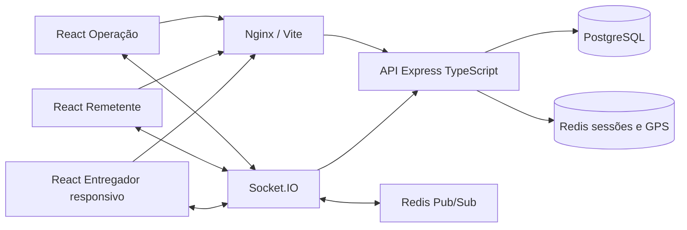

# Arquitetura e decisões

## Componentes

Monólito modular inicialmente: cadastros, autenticação, pedidos, despacho, rastreamento e financeiro. HTTP e socket compartilham os mesmos serviços e autorização. A divisão em serviços independentes só se justifica por demanda medida; banco e transações preservam a consistência financeira.

Estrutura atual: `src/dominio.ts` contém regras puras, `src/servicos.ts` transações e validações, `src/servidor.ts` transporte e autenticação e `src/painel.ts` consultas e cadastros integrados. `web/` é uma aplicação React/Vite/Tailwind com navegação e recursos conforme o perfil. Nginx entrega os arquivos compilados e encaminha API e WebSocket na mesma origem. React com Vite foi escolhido para o painel privado, que não depende de renderização no servidor. O caminho de execução local é `iniciar.bat`, com Docker Compose incluindo migração e seed. `exemplos/` preserva referências da primeira versão; o frontend executável está em `web/src/`.

## Dados e contas

Usuário é identidade; empresa e entregador são perfis vinculados 1:1. `emp_empresas` aceita FISICA/JURIDICA e CPF/CNPJ em `doc_emp`. Pessoa física futura pode ter perfil remetente sem empresa porque `ped_pedidos.id_emp` é opcional. O endpoint atual exige empresa ativa; para auto-cadastro futuro serão necessários verificação de contato, consentimento, prevenção de abuso e origem de coleta própria. Isso altera fluxos e endpoints, sem refazer as entidades principais.

Sem endpoint público de registro agora. Só administrador cria operadores; operação cadastra os demais. Uma instalação representa uma central logística. Múltiplas centrais exigirão `id_central` em usuários, preços, pedidos, sessões e índices; não confundir o isolamento por remetente com multi-tenancy de centrais.

Todos os valores financeiros usam NUMERIC(12,2) e Prisma.Decimal; a API recebe strings para evitar ponto flutuante. Datas de eventos usam timestamptz. Intervalos usam início inclusivo/fim exclusivo. Para dia de Fortaleza, envie por exemplo `2026-10-27T00:00:00-03:00` até `2026-10-28T00:00:00-03:00`, após o período terminar. `dt_ref` é etiqueta de data; os limites UTC são a fonte de verdade do período.

Relações: usuário→empresa/entregador; remetente/empresa/bairro→pedidos; entregador→pedidos/caixas; caixa/repasse→pedidos; pedido→histórico. Índices cobrem operação por status e data, histórico de empresa e conclusão do entregador. `num_ped` é referência legível; UUID é identificador da API.

Snapshot do endereço da loja, frete e ganho protege pedidos antigos contra alterações cadastrais. Bairro é FK obrigatória e ativo ao criar/editar. Desativação impede novos chamados, preservando histórico. Mudança manual de bairro mantém o preço contratado até o operador também informar nova taxa e ganho, com motivo.

## Estados da corrida

PREPARANDO → ATRIBUIDO → ACEITO → EM_COLETA → NO_LOCAL → EM_ENTREGA → CONCLUIDO. Com retorno, EM_ENTREGA → EM_RETORNO → CONCLUIDO. ORIGEM inverte o trajeto: coleta no endereço informado e entrega na loja. O snapshot distingue os dois pontos.

Aceite valida o entregador atual. Redespacho só ocorre antes do aceite. Versão otimista impede que duas telas sobrescrevam a mesma versão. Cancelamentos depois de iniciar a entrega precisam de fluxo de incidente e reversão financeira, ainda não implementado. Operadores têm leitura irrestrita e edição auditada dos pedidos abertos. Para manter caixa consistente, a base bloqueia reescrita de pedidos encerrados: ajustes pós-fechamento devem ser implementados como lançamentos compensatórios e auditados.

## Financeiro

Premissa comercial explícita: A_RECEBER cobra produto + frete; PAGO significa produto + frete pagos na loja. Cobrar apenas taxa pode ser representado com produto zero. Cobrar apenas parte do produto ou pagamento misto exige tabela de parcelas/recebimentos futura. Pagamento PIX_LOJA/CARTAO_LOJA ocorre direto à loja, sem dinheiro sob custódia do motoboy. PIX para a conta do entregador não é suportado nesta base.

Caixa: `saldo ADM = soma dinheiro sob custódia − soma ganhos do motoboy`. Dez recebimentos de R$ 100 e dez ganhos de R$ 7 resultam em R$ 930. Ganho difere da taxa comercial e inclui adicional de retorno contratado. Saldo negativo significa que o ADM deve ao entregador. Nunca truncar em zero. Só corridas concluídas entram no caixa; pagamento e ganho ficam vinculados a um único fechamento. Períodos sobrepostos com pedidos já vinculados são rejeitados, fechamento repetido retorna o existente; transação serializável com repetição em conflito evita apropriação simultânea.

Repasse à loja: `soma recebida em dinheiro − soma fretes de todos os pedidos concluídos do período`. No pagamento PAGO ou direto à loja, o resultado negativo representa frete devido ao ADM. Exemplo: R$ 100 em dinheiro e frete 7 → repasse 93. A quitação de repasse é confirmação contábil manual, sem transferência bancária automática. Use o mesmo processo para períodos diários, decenais ou mensais; no decenal defina 1–10, 11–20 e 21–fim do mês. O sistema não presume todo mês ter 30 dias.

Fechamento calcula valores; quitação exige comprovante e usuário validador no caixa. Conciliação de faltas, estornos, comprovantes de entrega, recebimento na coleta e conferência de PIX por integração bancária são extensões necessárias para operação real. O modelo atual reconhece dinheiro na conclusão, portanto não permite concluir/cancelar corridas com dinheiro recebido e sem conciliação.

## Tempo real e segurança

Tokens opacos aleatórios expiram em uma hora, hashes são chaves Redis e senha usa bcrypt. O frontend usa cookie HttpOnly/SameSite Strict e não armazena token no localStorage. Integrações podem usar Bearer. Requisições consultam usuário ativo; logout revoga token, limpa cookie e desconecta os sockets daquela sessão. WebSocket e mutações HTTP validam Origin quando presente. `COOKIE_SEGURO=true` deve ser configurado ao publicar com HTTPS; o ambiente local usa HTTP em loopback. Payloads de atualização contêm metadados mínimos. Salas são definidas no servidor, por usuário, sessão e operação.

O adapter Redis distribui eventos entre instâncias, sem persistência nem recuperação de eventos perdidos. Interfaces reconsultam HTTP após reconectar. Para evitar a janela entre commit e emissão em produção, implementar outbox transacional e worker com deduplicação por evento/versão. Esta base pode perder uma notificação se o processo falhar após o commit; o pedido persiste e a reconsulta recupera o estado. Transporte exclusivo WebSocket evita necessidade de afinidade por long-polling; proxies precisam permitir upgrade e ter timeout compatível.

GPS só é aceito de entregador atribuído a corrida ativa, com limites de coordenadas, horário e frequência. Última posição tem TTL de 120 segundos, sem trilha permanente. No mobile, permissões e serviço de background dependem do sistema operacional e de build nativo. Morte do app/restrição de bateria podem interromper rastreamento; apresentar posição indisponível/antiga, nunca fingir localização atual.

Redis e PostgreSQL ficam na rede interna do Compose, com publicação local para desenvolvimento. Produção exige TLS no proxy, segredos gerenciados, sem portas de dados publicadas, autenticação/ACL Redis, backup PostgreSQL com teste de restauração, monitoramento e retenção LGPD. Rate-limit atual é por processo: migrar contador para Redis ao escalar. Log de pedido é append-only na aplicação; restringir UPDATE/DELETE por papel de banco em produção. JSON de auditoria contém dados pessoais e requer controle de acesso e retenção.

## Limites e etapas seguintes

Entregue: backend, schema e migração; frontend web integrado com três perfis, busca, filtros, paginação, detalhes, edição e auditoria; cadastro transacional de parceiro e usuário; financeiro e CSV; integração GPS com mapa sob demanda; infraestrutura e testes de domínio, API e navegador. O nativo Expo permanece como referência, sem APK/IPA homologado. Continuam pendentes push nativo, roteirização, recuperação de senha, validação dos dígitos CPF/CNPJ, proteção distribuída de login, ajustes contábeis e deploy público.

Próximas fases: concluir aplicativo Expo, adicionar outbox e ledger financeiro, homologar em aparelhos reais, revisar segurança e realizar piloto acompanhado. Os prints são referência de fluxo, sem acesso ao software original ou reutilização de identidade visual.
